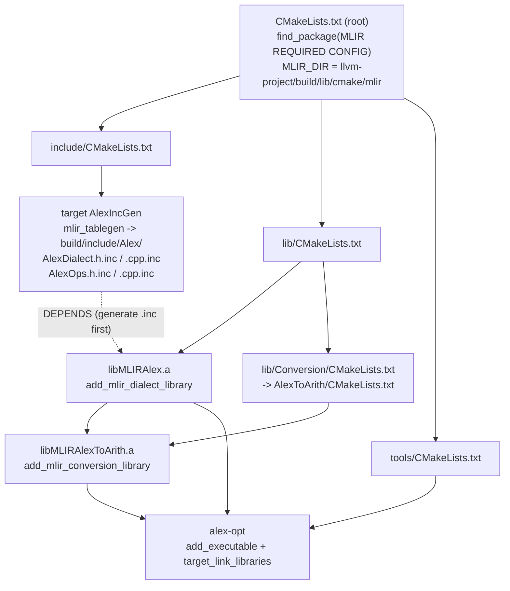
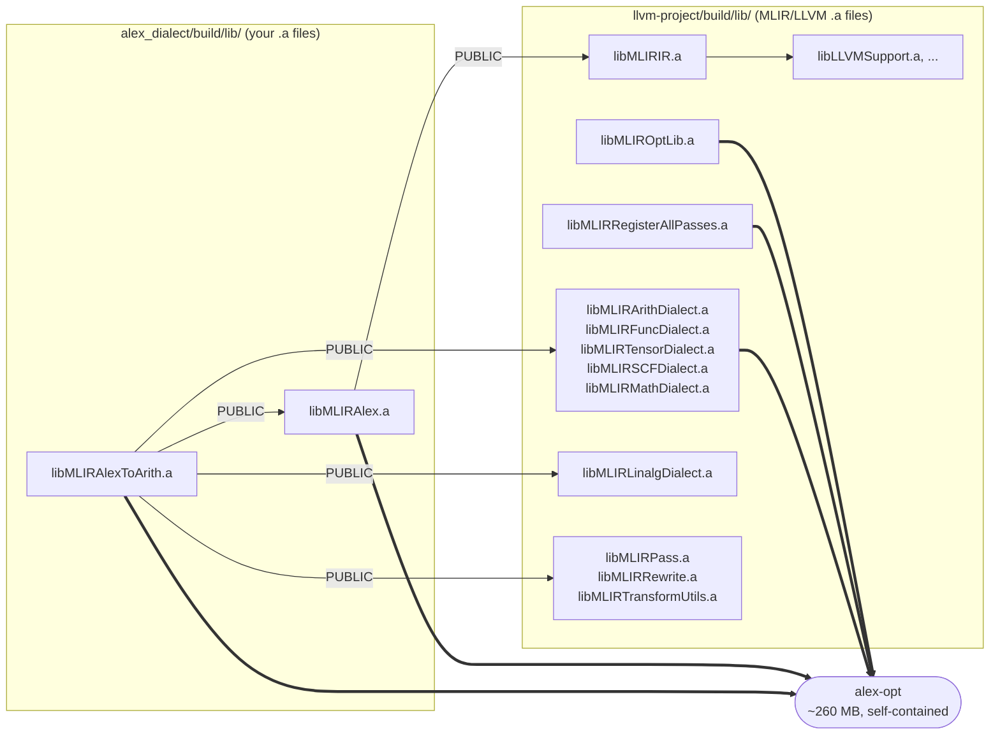
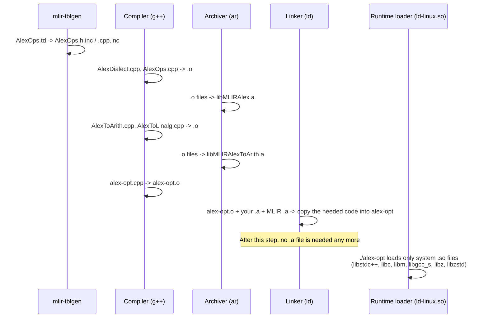

# How CMake builds and links `alex_dialect` (without Python bindings)

## 1. The short answer: there is no MLIR `.so`

The LLVM/MLIR build at `~/Documents/Jeoffrey/llvm+mlir/llvm-project/build` was configured with:

```
BUILD_SHARED_LIBS       = OFF  -> every MLIR/LLVM library is a static .a (libMLIRIR.a, libMLIRArithDialect.a, ...)
LLVM_BUILD_LLVM_DYLIB   = OFF  -> no libLLVM.so
MLIR_BUILD_MLIR_C_DYLIB = 0    -> no libMLIR-C.so
```

Your project then builds **static** libraries too, because `add_mlir_dialect_library` and
`add_mlir_conversion_library` follow `BUILD_SHARED_LIBS`.

So **without the Python bindings, no MLIR or Alex `.so` file exists anywhere.** Every library is a static
archive (`.a`), and the linker **copies** the code it needs into `alex-opt`. The only `.so` files loaded at runtime
are system libraries.

| File | Type | Comes from | What is inside |
|---|---|---|---|
| `build/lib/libMLIRAlex.a` | static | [lib/CMakeLists.txt](lib/CMakeLists.txt) | `AlexDialect.cpp`, `AlexOps.cpp` + TableGen `.inc` |
| `build/lib/libMLIRAlexToArith.a` | static | [lib/Conversion/AlexToArith/CMakeLists.txt](lib/Conversion/AlexToArith/CMakeLists.txt) | `AlexToArith.cpp`, `AlexToLinalg.cpp` |
| `llvm-project/build/lib/libMLIR*.a`, `libLLVM*.a` | static | your LLVM build | MLIR IR, the dialects, passes, LLVMSupport, ... |
| `build/tools/alex-opt` (~260 MB) | executable | [tools/CMakeLists.txt](tools/CMakeLists.txt) | **all of the above, copied in** |
| `/lib64/libstdc++.so.6`, `libc.so.6`, `libm.so.6`, `libgcc_s.so.1`, `libzstd.so.1` | shared | the OS | C/C++ runtime, compression |
| `/usr/local/lib64/libz.so.1` | shared | a locally installed zlib | compression (used by LLVM Support) |

---

## 2. Which CMakeLists.txt creates what



`find_package(MLIR)` loads `MLIRConfig.cmake`, which defines **imported targets** such as `MLIRIR`,
`MLIRArithDialect` and `MLIROptLib`. Each imported target is a name pointing at a `.a` file in
`llvm-project/build/lib/`, plus the list of libraries it depends on. When you write `MLIRArithDialect` in
`target_link_libraries`, CMake turns it into `.../llvm-project/build/lib/libMLIRArithDialect.a`.

---

## 3. The link graph for `alex-opt`

[tools/CMakeLists.txt](tools/CMakeLists.txt):

```cmake
target_link_libraries(alex-opt PRIVATE
    MLIRAlex MLIROptLib MLIRRegisterAllPasses
    MLIRArithDialect MLIRFuncDialect MLIRTensorDialect
    MLIRSCFDialect MLIRMathDialect MLIRAlexToArith)
```



- **Thick arrows** are the libraries named directly in `tools/CMakeLists.txt`.
- **`PUBLIC` arrows** come from the `LINK_LIBS PUBLIC` sections of your library CMakeLists. `PUBLIC` means
  "anyone who links me also links these". `alex-opt` gets `libMLIRLinalgDialect.a`, `libMLIRPass.a` and the
  others through `MLIRAlexToArith`, even though `tools/CMakeLists.txt` never names them.
- `MLIROptLib` and `MLIRRegisterAllPasses` pull in most of MLIR the same way, through their own dependencies. That is
  why the binary is about 260 MB.

---

## 4. What happens at build time vs. runtime



Static vs. shared, in one line:

- **`.a` (static):** used **at link time**. Its code is **copied** into the executable, and the `.a` is not needed
  afterwards.
- **`.so` (shared):** used **at runtime**. The executable only records the name, and the loader finds the file each
  time the program starts (through RPATH, `LD_LIBRARY_PATH` or `/etc/ld.so.conf`).

---

## 5. Folder layout

```
llvm-project/build/                            <- MLIR_DIR points into here
└── lib/
    ├── cmake/mlir/MLIRConfig.cmake            <- defines the imported targets (MLIRIR, MLIRArithDialect, ...)
    ├── libMLIRIR.a
    ├── libMLIRArithDialect.a
    ├── libMLIROptLib.a
    └── ... (all static, link time only)

alex_dialect/build/
├── include/Alex/*.inc                         <- TableGen output (target AlexIncGen)
├── lib/
│   ├── libMLIRAlex.a                          <- link time only
│   └── libMLIRAlexToArith.a                   <- link time only
└── tools/
    └── alex-opt                               <- the only thing you run; contains everything
```

---

## 6. Check it yourself

```bash
cd alex_dialect

# 1. LLVM/MLIR are static
grep -E "^(BUILD_SHARED_LIBS|LLVM_BUILD_LLVM_DYLIB)" \
  ~/Documents/Jeoffrey/llvm+mlir/llvm-project/build/CMakeCache.txt
ls ~/Documents/Jeoffrey/llvm+mlir/llvm-project/build/lib/libMLIRIR.*      # only .a

# 2. alex-opt loads only system .so files
ldd build/tools/alex-opt

# 3. Your code is really copied inside alex-opt
nm -C build/tools/alex-opt | grep -i "AlexToArith" | head

# 4. See the exact link command CMake generated (all the .a paths)
ninja -C build -t commands alex-opt | tail -1 | tr ' ' '\n' | grep '\.a$'
```

---

## 7. If you wanted `.so` files instead

Rebuild LLVM/MLIR with `-DBUILD_SHARED_LIBS=ON`, then reconfigure this project. Every
`add_mlir_*_library` would then produce `libMLIRAlex.so` and `libMLIRAlexToArith.so`, and `alex-opt` would load
`libMLIRIR.so` and the other MLIR libraries from `llvm-project/build/lib/` at startup, found through the RPATH that
CMake sets. The binary gets much smaller, and rebuilds link faster. The cost is that the program now depends on those
`.so` files being present.
